# Соседи — сервер сайта

Бэкенд для сайта «Соседи» (подбор соседа для совместной аренды жилья).
Команда 007, проект «Первый БИТ».

- **Язык:** Python 3.10+
- **Фреймворк:** FastAPI, запуск через Uvicorn
- **База данных:** SQLAlchemy. Локально — файл `sosedi.db` (SQLite, создаётся сам), на хостинге — PostgreSQL (Neon) по адресу из переменной `DATABASE_URL`
- **Фото анкет:** загружаются с устройства, сервер обрезает их в квадрат 640×640 и хранит в базе
- **Монетизация:** подписка «Соседи+» (демо-оплата)
- **Фронт:** лежит в папке `docs`, сервер отдаёт его по адресу `/site/`

**Общая ссылка на сайт:** https://sosedi.onrender.com/site/

## Как запустить

Нужен Python 3. Проверить: `python3 --version`

Скачать проект: на странице репозитория зелёная кнопка **Code → Download ZIP**, распаковать. Или `git clone https://github.com/Fuki351/sosedi.git`

Сайт без сервера (только страницы): https://fuki351.github.io/sosedi/

```bash
# 1. перейти в папку проекта (после ZIP она называется sosedi-main)
cd sosedi

# 2. поставить библиотеки (один раз)
pip3 install -r requirements.txt

# 3. запустить сервер
python3 -m uvicorn main:app --reload --port 3000
```

После запуска открыть в браузере:

| Адрес | Что там |
|---|---|
| http://localhost:3000/ | «Привет, это сервер моего сайта» |
| http://localhost:3000/time | текущее время в JSON |
| http://localhost:3000/random | случайное число |
| http://localhost:3000/docs | все запросы API, можно выполнить прямо в браузере |
| http://localhost:3000/site/ | сам сайт, который берёт данные с сервера |

Остановить сервер: `Ctrl + C` в терминале.

## Тестовые пользователи

| Логин | Пароль | Что у него есть |
|---|---|---|
| `ivan` | `qwerty` | анкета есть; Аня и Вика уже отметили его «Интересно» |
| `anya` | `12345` | анкета есть |
| `maria` | `maria1` | анкеты нет — можно заполнить и опубликовать |

Можно и зарегистрироваться самому: вкладка «Регистрация» на странице входа.

## Структура

```
sosedi/
├── main.py           — сервер: все адреса (эндпоинты) и логика
├── security.py       — защита: заголовки безопасности, лимиты запросов
├── yookassa.py       — запросы к ЮKassa: создать платёж, узнать статус
├── db.py             — база данных: таблицы и демо-данные при первом запуске
├── data.py           — справочники (вопросы, тарифы) и демо-анкеты
├── requirements.txt  — какие библиотеки нужны
├── render.yaml       — настройки хостинга Render
├── docs/             — фронт (HTML, CSS, JS)
│   ├── js/api.js     — общая функция запросов к серверу, подставляет токен
│   ├── login.html    — вход и регистрация
│   ├── premium.html  — подписка «Соседи+»: тарифы и оплата
│   ├── catalog.html  — анкеты с сервера, фильтры
│   ├── profile.html  — карточка: совместимость, «Интересно», жалоба
│   ├── anketa.html   — анкета, сохраняется на сервер
│   └── my.html       — «Мои отметки» текущего пользователя
└── screenshots/      — скриншоты работы
```

## Эндпоинты

🔒 — нужен токен в заголовке `Authorization: Bearer <токен>`, его выдаёт `/api/login`.

| Метод | Адрес | Что делает |
|---|---|---|
| GET | `/` | приветствие |
| GET | `/time` | текущее время |
| GET | `/random` | случайное число от 1 до 100 |
| POST | `/api/register` | регистрация: логин, пароль, имя → токен |
| POST | `/api/login` | вход: логин и пароль → токен |
| GET | `/api/me` 🔒 | кто я, есть ли анкета, подписка, сколько отметок осталось сегодня |
| GET | `/api/profiles` | все анкеты. Фильтры: `gender`, `housing`, `budget`, `university`, `place`, `course` (например `1,2`), `when`, `sleep` (`lark`/`owl`), `guests=rare`, `tidy`, `quiet`, `with_photo`, `no_smoke`, `no_pets`, `min_match`. Сортировка `sort`: `match` / `new` / `budget` |
| GET | `/api/questions` | вопросы анкеты (по ним фронт строит форму) |
| GET | `/api/profiles/{id}` | одна анкета. С токеном — ещё сравнение по каждому вопросу; Telegram только при взаимном интересе |
| POST | `/api/profiles` 🔒 | добавить свою анкету |
| PUT | `/api/profiles/{id}` 🔒 | отредактировать свою анкету (фото, отметки и подписка сохраняются) |
| DELETE | `/api/profiles/{id}` 🔒 | удалить анкету (только свою) |
| POST | `/api/profiles/{id}/photo` 🔒 | загрузить фото к своей анкете (форма с файлом) |
| DELETE | `/api/profiles/{id}/photo` 🔒 | убрать фото |
| GET | `/api/photos/{id}` | само фото анкеты (JPEG) |
| POST | `/api/interests` 🔒 | отметить анкету «Интересно». В ответе — взаимно или нет |
| GET | `/api/interests` | все отметки, с именами вместо id |
| GET | `/api/interests/my` 🔒 | мои отметки + кто отметил меня (список — только с «Соседи+») |
| GET | `/api/premium` | тарифы подписки и статус |
| POST | `/api/premium/checkout` 🔒 | оплатить подписку: создаёт платёж в ЮKassa и возвращает ссылку на оплату |
| GET | `/api/premium/payments/{id}` 🔒 | статус своего платежа (сервер сверяет его с ЮKassa) |
| POST | `/api/yookassa/webhook` | уведомления от ЮKassa об оплате |
| POST | `/api/reports` 🔒 | пожаловаться на анкету |

## Что сервер считает сам (бизнес-логика)

- **Процент совместимости.** Сравнивает ответы на 15 вопросов: одинаковый ответ — 1 балл, соседний вариант — 0,5, противоположный — 0. Сумма делится на число вопросов, на которые ответили оба.
- **Пол.** Не показываем анкеты тех, кто ищет соседа другого пола.
- **Сортировка.** Если вошёл, сверху анкеты с самой высокой совместимостью; свою анкету в списке не показывает.
- **Метки на карточках** («Не курит», «Есть питомец» и т.д.) — из ответов анкеты.
- **Взаимный интерес.** Telegram отдаётся, только если оба отметили друг друга.
- **Проверки при создании анкеты:** имя не пустое, курс от 1 до 6, Telegram в правильном формате, ответы на все 15 вопросов, пол и кого ищет, одна анкета на пользователя.
- **Права.** Удалить можно только свою анкету. При удалении убираются и все отметки с ней.
- **Дата** у отметок и жалоб ставится сервером.
- **Пароли** хранятся в базе не как есть, а как хеш (PBKDF2 с солью).

## Монетизация: подписка «Соседи+»

Основное бесплатно: анкета с фото, совместимость, контакты при взаимном интересе.

| | Бесплатно | Соседи+ |
|---|---|---|
| Отметок «Интересно» | 5 в сутки | без лимита |
| Кто отметил тебя | только число | имена, фото, совместимость |
| Место в каталоге | обычное | выше всех, значок ★ |
| Цена | 0 ₽ | 199 ₽ / месяц или 449 ₽ / 3 месяца |

Оплата идёт через **ЮKassa**:

1. Человек выбирает тариф → сервер создаёт платёж в ЮKassa (`POST /api/premium/checkout`) и отправляет человека на страницу оплаты.
2. После оплаты ЮKassa возвращает его на `premium.html?payment=номер`, страница спрашивает сервер о статусе.
3. ЮKassa присылает уведомление на `POST /api/yookassa/webhook`. Телу уведомления сервер не доверяет: берёт id платежа и сам запрашивает статус у ЮKassa. Подписка включается только при статусе `succeeded`, один раз за платёж.

Ключи магазина задаются в Render → Environment: `YOOKASSA_SHOP_ID` и `YOOKASSA_SECRET_KEY`. Если их нет, сайт работает в демо-режиме (подписка включается сразу). В тестовом магазине ЮKassa платят тестовой картой `5555 5555 5555 4477`, деньги не списываются.

## Деплой: общая ссылка

Сайт и сервер работают по одной ссылке на Render, данные — в PostgreSQL на Neon.

1. **Neon** (neon.tech) → New Project → скопировать адрес подключения `postgresql://...`
2. **Render** (render.com) → войти через GitHub → New → Blueprint → выбрать репозиторий `sosedi`. Render сам прочитает `render.yaml`
3. В поле `DATABASE_URL` вставить адрес из Neon → Apply
4. Через пару минут сайт будет по адресу https://sosedi.onrender.com/site/

На бесплатном тарифе Render сервер засыпает, если на сайт 15 минут никто не заходит. Первое открытие после этого занимает около минуты.

## Примеры запросов (curl)

```bash
# вход — в ответе token
curl -X POST http://localhost:3000/api/login \
  -H "Content-Type: application/json" \
  -d '{"login": "ivan", "password": "qwerty"}'

# анкеты в общежитии, с процентом совместимости (подставь свой токен)
curl "http://localhost:3000/api/profiles?housing=dorm" \
  -H "Authorization: Bearer ТОКЕН"

# одна анкета
curl http://localhost:3000/api/profiles/1 -H "Authorization: Bearer ТОКЕН"

# отметить «Интересно» → {"mutual": true, "telegram": "@sosedi_demo_anya"}
curl -X POST http://localhost:3000/api/interests \
  -H "Authorization: Bearer ТОКЕН" \
  -H "Content-Type: application/json" \
  -d '{"to_id": 1}'

# мои отметки
curl http://localhost:3000/api/interests/my -H "Authorization: Bearer ТОКЕН"

# без токена добавить анкету нельзя → {"detail": "Нужно войти"}
curl -X POST http://localhost:3000/api/profiles \
  -H "Content-Type: application/json" \
  -d '{"name":"Тест","course":1,"telegram":"@test_user","housing":"flat","budget":"lt20","answers":[0,0,0,0,0,0,0,0,0]}'

# чужую анкету удалить нельзя → {"detail": "Удалить можно только свою анкету"}
curl -X DELETE http://localhost:3000/api/profiles/1 -H "Authorization: Bearer ТОКЕН"
```

## Скриншоты

**Первый сервер:** `/`, `/time`, `/random`

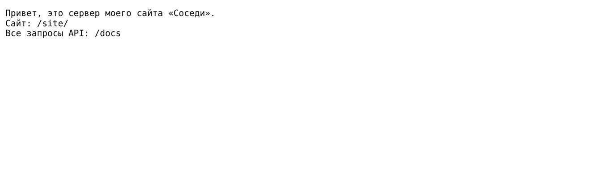
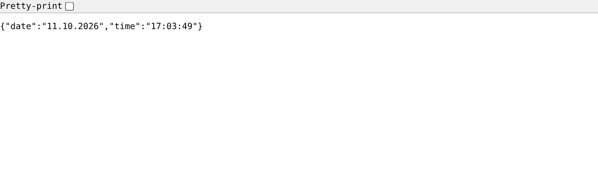
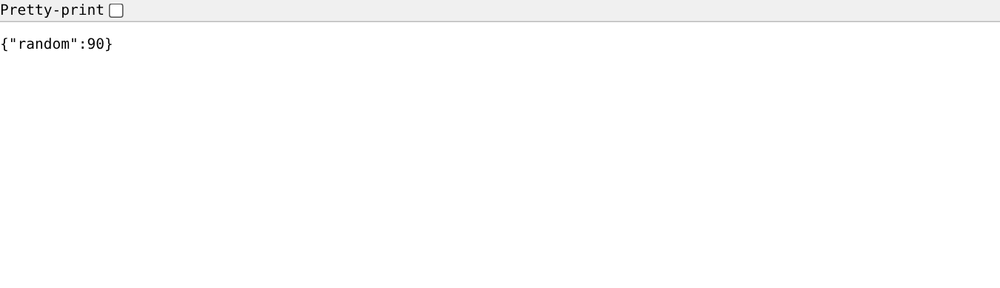

**Все эндпоинты в /docs и их выполнение**

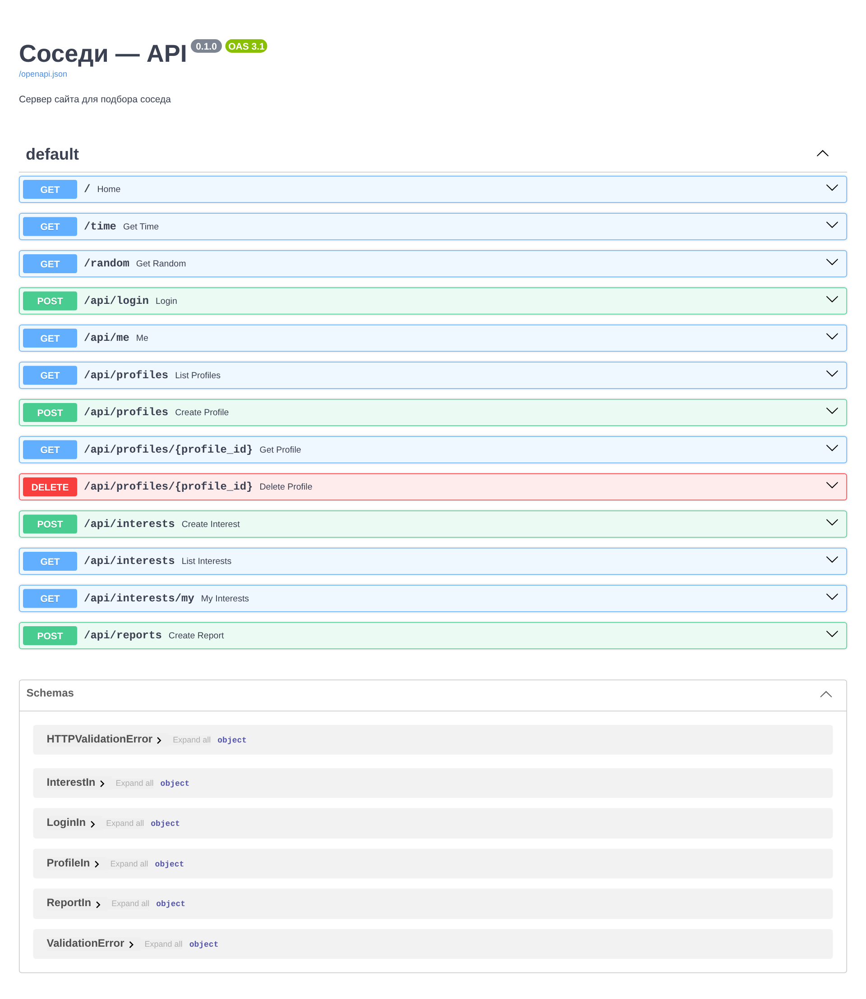
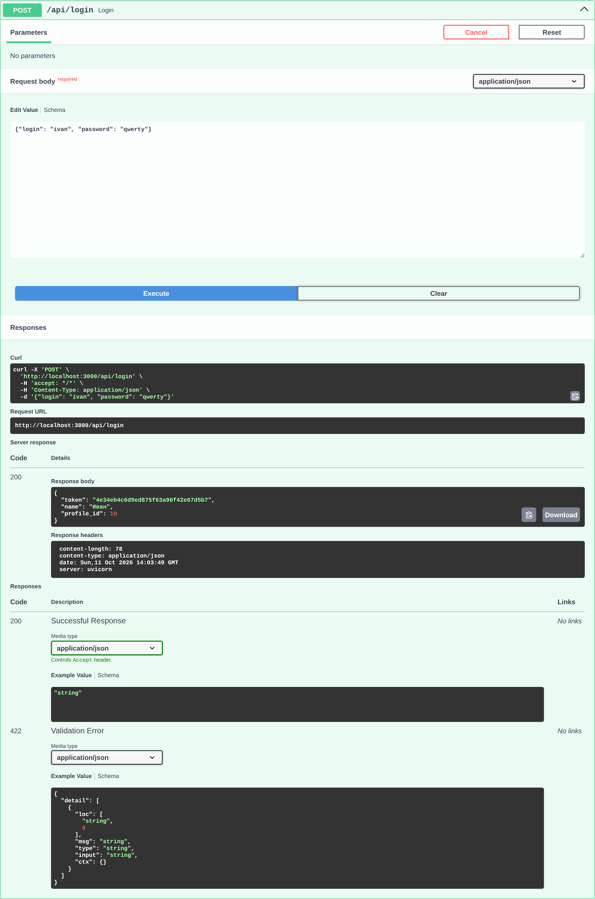
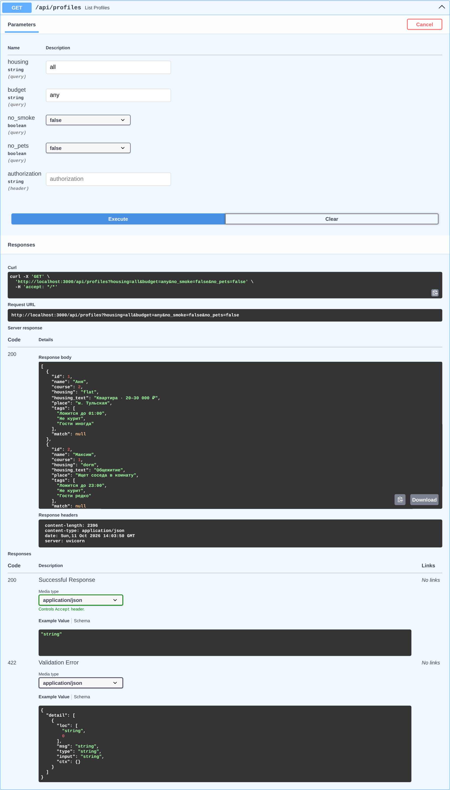

**Полный сценарий на сайте: вход → данные с сервера → «Интересно» → «Мои отметки»**

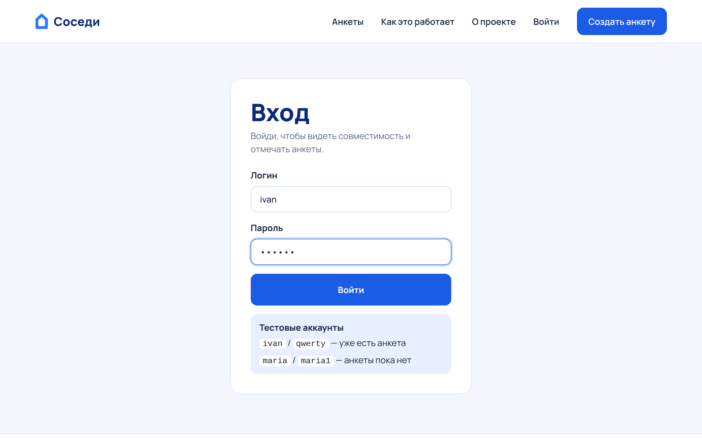
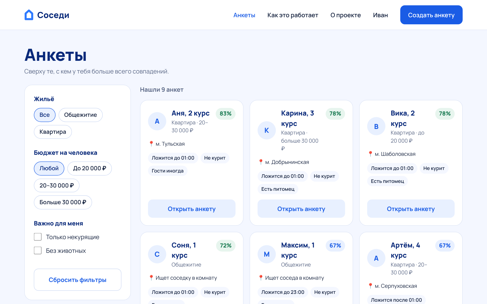
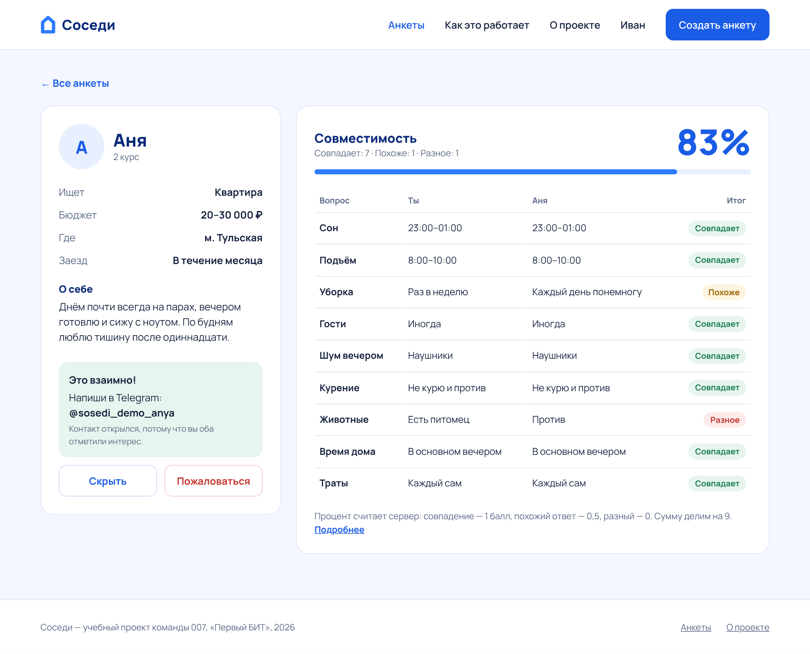
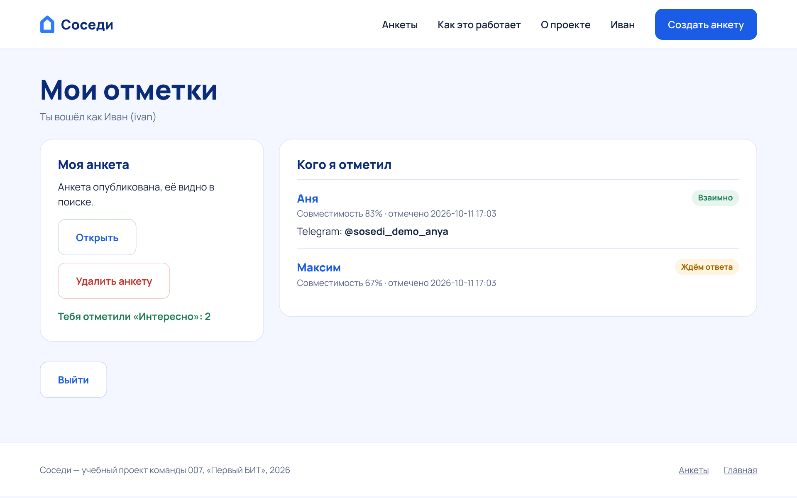
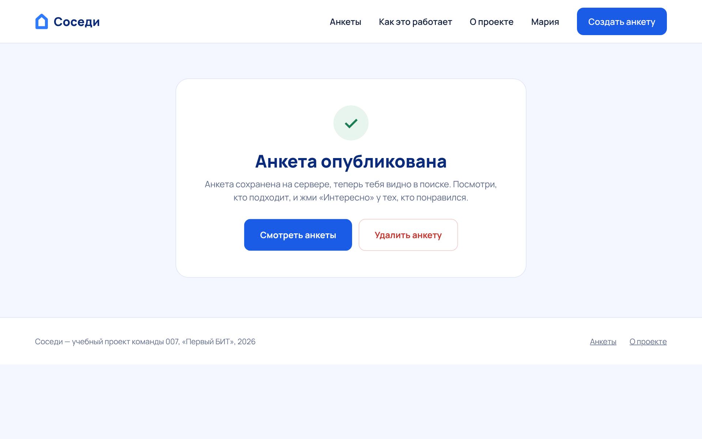

**Обновление: база данных, фото, подписка, регистрация**

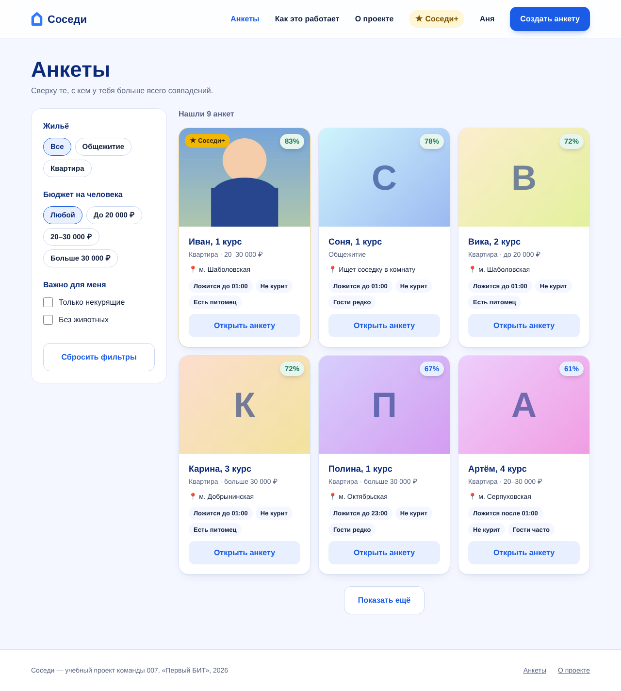
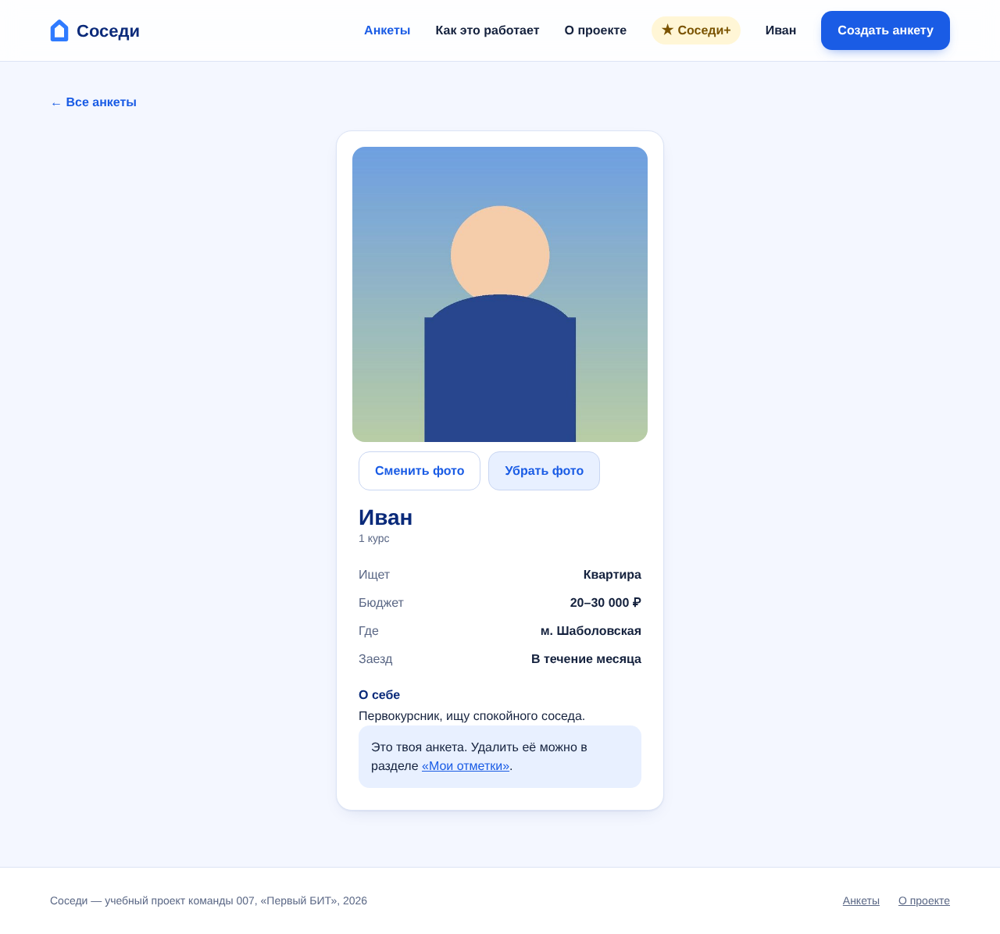
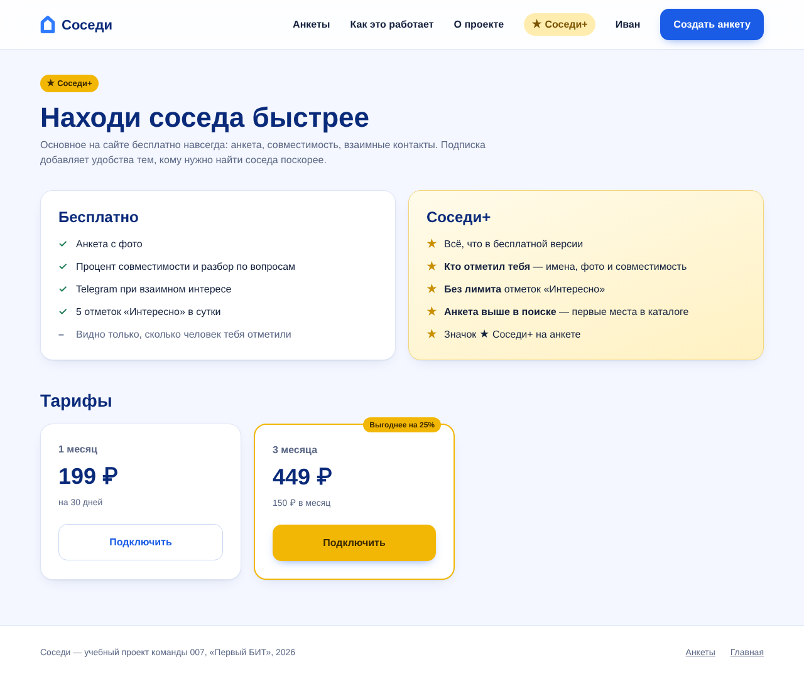
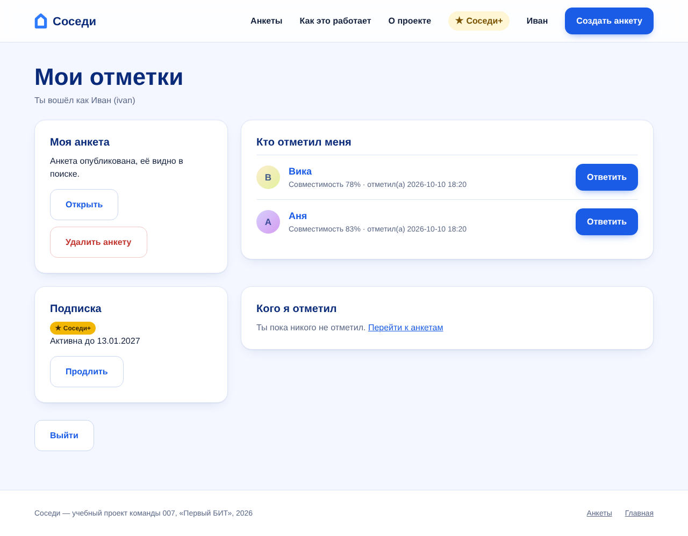
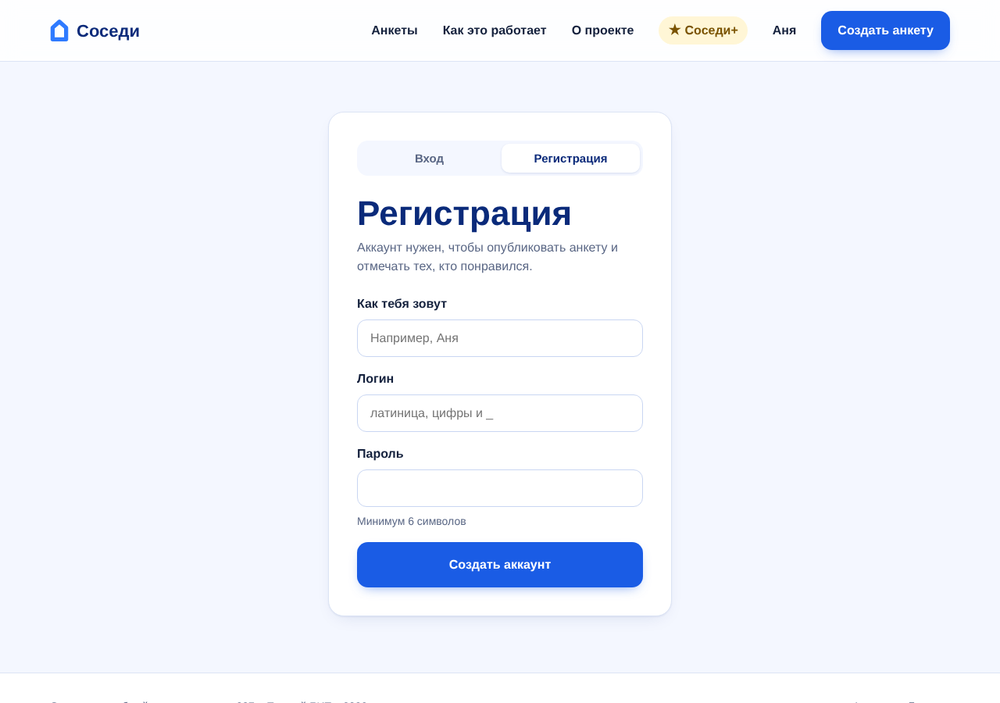
